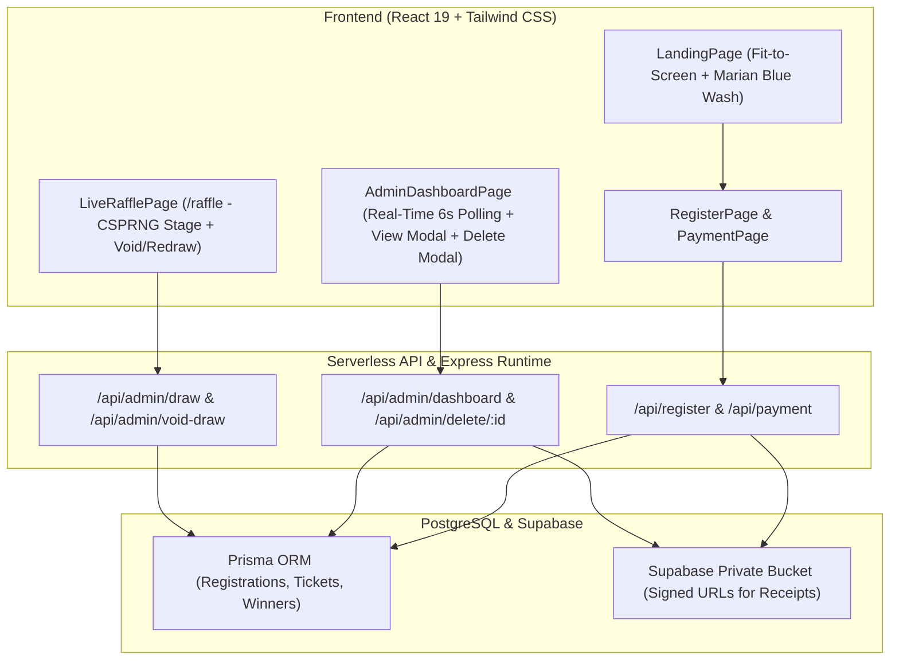

# PR: Live CSPRNG Raffle Stage, Real-Time Admin Metrics, Record Deletion & UI Hardening

## Summary



```diff
 DYDWebsite/
+├── api/admin/delete/[id].ts        # Permanent cascading record deletion
+├── api/admin/draw.ts               # CSPRNG draw engine with SHA-256 tamper hashing
+├── api/admin/void-draw.ts          # Operator Void & Redraw mechanism
+├── api/admin/winners.ts            # Confirmed winners audit query
+├── frontend/src/components/
+│   ├── SiteBackground.tsx          # Marian blue gradient wash & centered church background
+│   ├── EventBanner.tsx             # Responsive branded event banner
+│   ├── GcashQR.tsx                 # High-res GCash payment QR
+│   └── Logo.tsx                    # Official DYD 2026 SVG logo
+├── frontend/src/pages/
+│   ├── LiveRafflePage.tsx          # Full-screen drumroll animation + stage modals
+│   └── AdminDashboardPage.tsx      # Real-time metrics sync, receipt preview, reason-free delete
+└── dev-all.js                      # Unified concurrent local runner
```

- **Fit-to-Screen & UI Aesthetics:** Applied fit-to-screen scale across all pages with centered church gathering background (`mix-blend-multiply`, Marian blue overlay).
- **Proof-of-Payment Viewer:** Fixed image preview by resolving signed URL bindings on both backend and frontend.
- **Admin Dashboard Real-Time Sync:** Auto-polls every 6 seconds without UI flicker; accurately calculates global counts for `totalSubmissions`, `pending`, `eligible`, `rejected`, and `confirmedWinners`.
- **Permanent Cascading Deletion:** Complete removal of registrations, associated tickets, and winner entries with in-app dual confirmation dialogs and zero reason prompts.
- **Zero Browser Popups:** Replaced all native `alert()`, `confirm()`, and `prompt()` calls with accessible, styled Tailwind modal dialogs.
- **Clean Repo Hygiene:** Excluded all internal agents, skills, and scratch artifacts in `.gitignore`.

---

## Evidence

- **Before:**
  - View proof button did not open receipt images (`proofOfPaymentPath` undefined).
  - Deleting an entry required typing a native browser prompt reason and only soft-flagged records without ticket purging.
  - Metrics in Admin Dashboard went out of sync when filtering or when entries changed on the server.
  - Native `alert()` dialogs disrupted the operator experience on `/raffle` and `/admin/dashboard`.
- **After:**
  - `npm run check:all` passes cleanly:
  ```text
  > npm run typecheck && npm run db:check
  > tsc --noEmit && tsc --noEmit --project frontend/tsconfig.json
  > prisma db push --skip-generate
  The database is already in sync with the Prisma schema.
  Exit code: 0 (0 TypeScript errors)
  ```
  - Receipts display instantly in an in-app lightbox with a 1-click "Open Full Size ↗" shortcut.
  - Metric counters poll dynamically in the background every 6s without screen flashing.
  - Records delete permanently from both UI state and PostgreSQL via Prisma cascade.

---

## Merge Danger

**Door:** Two-way

All backend schema migrations and serverless endpoints are backward-compatible. API changes preserve existing database contracts while adding cascading delete and CSPRNG audit records.

**Blast Radius:** Low

Modifications are scoped to DYD26 administrative and raffle presentation surfaces. Public registration flow and payment proof uploads remain stable and validated by Zod contracts.

